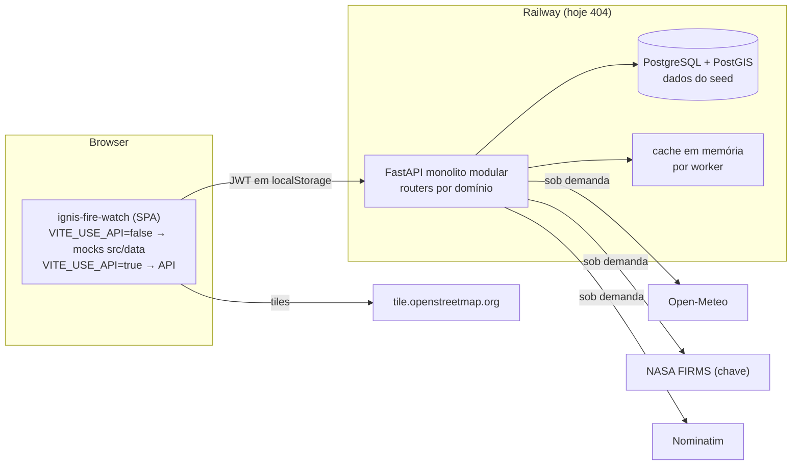
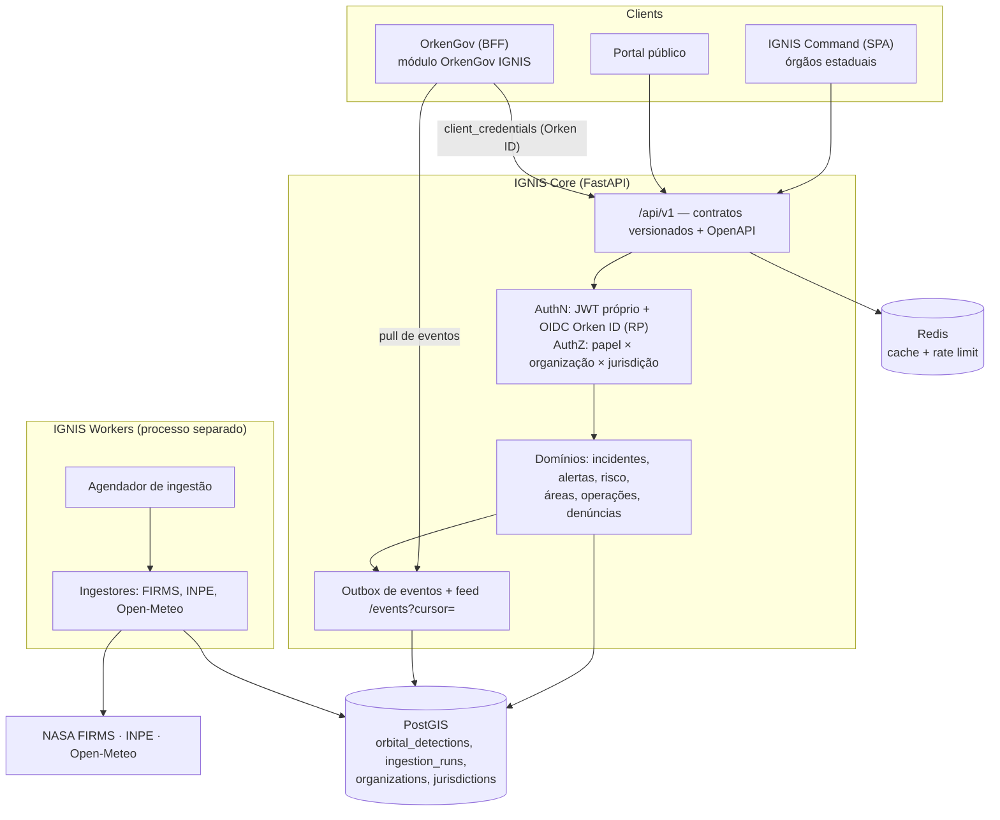

# IGNIS — Arquitetura atual e proposta

Data: 03/11/2026.

## 1. Stack efetiva (verificada)

| Camada | Tecnologia | Versão efetiva | Fonte |
|---|---|---|---|
| Backend | Python + FastAPI + Uvicorn | Python 3.12; FastAPI ≥ 0.115 (sem lockfile, ver X-02) | `pyproject.toml` |
| ORM / migrations | SQLAlchemy 2 async + asyncpg, Alembic (15 revisões, head `438a82832b4f`) | — | `alembic/versions/` |
| Banco | PostgreSQL 16 + PostGIS 3.4 (`postgis/postgis:16-3.4`) | — | `docker-compose.yml` |
| Auth | JWT HS256 (PyJWT), bcrypt (passlib) | 480 min | `app/core/security.py` |
| Deploy backend | Docker no Railway (`entrypoint.sh`: migra, seed e uvicorn com 2 workers) | API documentada **fora do ar** (404) | X-03 |
| Frontend | React 18 + TypeScript 5 + Vite 5 + Tailwind/shadcn + TanStack Query 5 + react-router 6 + Leaflet 1.9/react-leaflet 4 + framer-motion | `package-lock.json` | `package.json` |
| Deploy frontend | Vercel (SPA rewrite), branch de produção provável `master` | `ignis-fire-watch.vercel.app` → 200 | `vercel.json` |
| Testes | pytest + pytest-asyncio (158 testes); Vitest (24 testes, Sprint 0) | — | SPRINT-0-DELIVERY |

## 2. Arquitetura atual (as-is)

**Organização do backend:** cada domínio tem `router.py`, `service.py`, `schemas.py` e `model.py` (`auth`, `users`, `protected_areas`, `reports`, `incidents`, `teams`, `resources`, `missions`, `evidence`, `esg`, `audit`, `aurora`, `war_room`, `admin`, `integrations/*`).

- **Pontos positivos:** separação router/service, Pydantic v2, auditoria em operações de escrita, papel relido do banco a cada requisição, PostGIS com índices GIST (`a012`), testes rápidos sem banco.
- **Limitações estruturais:**
  1. sem entidade de instituição (B-07);
  2. integrações sem persistência nem agendamento (B-14);
  3. estado de processo em memória (cache, rate limit) incompatível com múltiplos workers;
  4. incidentes sem máquina de estados (B-12);
  5. drift de timezone nos modelos (B-13);
  6. sem CI (X-02);
  7. o frontend mistura dois modos (mock/API) no mesmo build, com fallback por hook.

## 3. Arquitetura proposta (to-be)

**Decisão:** manter o backend Python como **serviço especializado (IGNIS Core)**. Os motivos:

- o ecossistema geoespacial e científico é Python (Shapely, GeoAlchemy2, pyproj e, no futuro, rasterio/xarray);
- PostGIS já está modelado;
- a integração com o OrkenGov (Next.js/Prisma) deve acontecer por API e eventos, sem banco compartilhado. Esse é o precedente da ADR-0020 do OrkenGov.

Não encontrei evidência técnica que justifique reescrever em outra stack.

Princípios:

1. **Ingestão separada da leitura.** Workers gravam no banco (`orbital_detections`, com `observed_at`, `ingested_at`, `source`, geometria e chave de deduplicação). A API só lê do banco, e a UI nunca dispara chamada externa.
2. **Rastreabilidade obrigatória** em todo registro (ver DATA-SOURCES §5) e **`ingestion_runs`** com o resultado real de cada execução: buscados, válidos, inseridos, duplicados, erro.
3. **Multi-organização:**
   - `organizations` (CBMCE, Defesa Civil estadual, municípios via OrkenGov), `jurisdictions` (geometria e código IBGE) e `memberships` (usuário × organização × papel);
   - toda consulta é filtrada por organização ou jurisdição no **service**, nunca só na UI;
   - o compartilhamento estadual → municipal é explícito, por política.
4. **Detecção ≠ incidente.** O pipeline é: detecção orbital → alerta interno (correlação, risco) → **validação humana** → incidente. Nenhum passo automático cria incidente ou notifica órgão.
5. **Ações operacionais** passam por máquina de estados, motivo obrigatório, papel mínimo e auditoria append-only. Ações com efeito externo só existem com integração oficial e flag por organização.
6. **Um build por modo.** O modo demonstrativo vira um ambiente separado (`demo.`), com banco de seed. O build operacional não contém mocks.

## 4. Mapa geográfico — recomendação para a Fase 1

**Situação atual** (verificada no código):
- Leaflet + react-leaflet com tiles OSM e projeção Web Mercator (EPSG:3857), corretas. Não é "gradiente com pontos CSS".
- Os elementos posicionados não têm coordenada própria: o foco é desenhado no centro da área e as equipes em offsets inventados (F-11).
- Os alertas FIRMS não são plotados.

| Opção | Prós | Contras | Quando |
|---|---|---|---|
| **Leaflet (manter)** | Já integrado em 9 telas; simples; plugins de cluster e heatmap; raster ou vector via plugins | Desempenho limitado acima de cerca de 10 mil marcadores sem cluster/canvas; estilo vetorial limitado | **Fase 1 (recomendado)** |
| MapLibre GL JS | WebGL, vector tiles, estilos, milhares de pontos, 3D/terreno; open source | Reescrita dos componentes de mapa; bundle maior; curva de estilo | Fase 3, se a War Room exigir camadas densas e vector tiles |
| OpenLayers | Projeções arbitrárias, WMS/WFS nativos (INPE/IBGE) | API verbosa; reescrita | Só se a integração WMS/WFS pesada virar requisito |

**Recomendação.** Manter o Leaflet na Fase 1 e corrigir a semântica:

- plotar as `orbital_detections` com coordenada real, em cluster ou canvas renderer;
- dar lat/lng próprios ao incidente (o backend já tem `latitude`/`longitude`/`location` em `incidents`);
- usar as posições reais das equipes (`current_latitude/longitude`);
- adicionar legenda com fonte e horário por camada;
- trocar o provedor de tiles por um contratado (MapTiler, Stadia, Esri) ou servidor próprio com atribuição correta.

Reavaliar MapLibre na Fase 3 com métricas: número de feições e FPS na War Room.

## 5. Decisões arquiteturais (ADR resumidas)

| # | Decisão | Alternativas consideradas | Motivo |
|---|---|---|---|
| D-1 | IGNIS Core permanece em Python/FastAPI | Reescrever em Node/Next junto ao OrkenGov | Ecossistema geoespacial; código já modular; integração por contrato evita acoplamento |
| D-2 | Integração com o OrkenGov por API com credencial de serviço + feed de eventos (pull) | Banco compartilhado; iframe; webhook push | Ver ORKENGOV-INTEGRATION §4 |
| D-3 | Workers de ingestão separados da API, persistência em PostGIS | Fetch sob demanda (situação atual) | Rastreabilidade, histórico, deduplicação, não expor a cota externa à carga de usuários |
| D-4 | Em modo API, a UI não substitui dados ausentes por mocks | Fallback silencioso (situação anterior) | Confiabilidade é requisito de segurança |
| D-5 | Leaflet na Fase 1, MapLibre reavaliado na Fase 3 | Migrar já | Evitar reescrita sem necessidade demonstrada |
| D-6 | Estado compartilhado (cache, rate limit) em Redis a partir da Fase 1 | Memória por processo | Múltiplos workers/réplicas |
