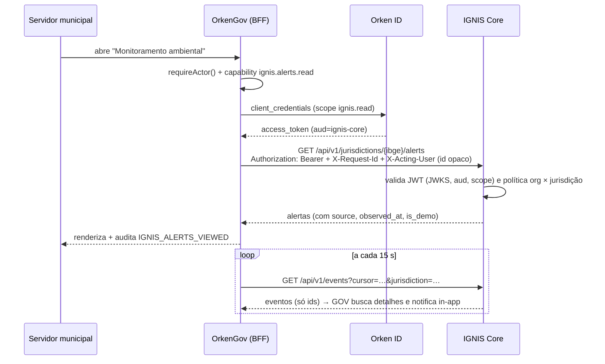

# IGNIS × OrkenGov — Arquitetura de integração (proposta)

Data: 03/11/2026. Base: análise **somente leitura** do repositório `orkengov` (main `1e07f56`). Nada foi alterado no OrkenGov e **nada foi implementado** nesta sprint.
Marcação: os fatos citam caminhos do repositório OrkenGov; **[Inferência]** marca conclusões que não estão escritas lá.

> Nenhuma das iniciativas comerciais (oferta ao CBMCE, à Defesa Civil estadual ou a municípios) existe como contrato ou autorização. Este documento é só técnico.

## 1. O que o OrkenGov é hoje (fatos relevantes)

| Tema | Fato | Fonte |
|---|---|---|
| Stack | Next.js 16 (App Router), React 19, Prisma 7, PostgreSQL 18, Auth.js v5, Zod 4 | `package.json` |
| Deploy | Railway via IaC (`.railway/railway.ts`); ambientes `production` e `staging` seguem as branches `production`/`staging` (não `main`) | `.railway/railway.ts:20-35` |
| Login de servidores | Auth.js (JWT de sessão, 12 h). Provider Credentials (bcrypt, rate limit, auditoria) e **OIDC "Orken ID"** (Orken Platform, PKCE) | `lib/auth/auth.ts`, `lib/auth/orken.ts`, ADR-0020 |
| Papel do usuário | Fica no banco do GOV; não vai no token do Orken ID | ADR-0020 §3, `lib/auth/actor.ts` |
| Serviço → serviço (saída) | Cliente OAuth2 `client_credentials` no Orken ID, com discovery validado, cache de token, timeout de 5 s e falha fechada | `lib/platform/client.ts`, `lib/platform/config.ts` |
| Serviço → GOV (entrada) | Só `CRON_SECRET` em `/api/cron/*`. **Não há** API pública, `/api/v1`, OpenAPI, API key por cliente nem webhook de entrada | `lib/http/cron.ts`, `docs/ROADMAP.md:47` |
| Tenancy | **Single-tenant por implantação**: `currentTenant()` devolve a única linha de `tenants`. Produção = tenant ligado à organização `general-sampaio` | `lib/tenancy/index.ts`, `docs/OPERATIONS.md:670` |
| Identificação do município | `Tenant` **não tem** código IBGE, UF, CNPJ nem geometria. Tem `slug` e `platformOrganizationId` | `prisma/schema.prisma:755-795` |
| Autorização | RBAC por faixas (`lib/permissions/roles.ts`) + políticas por recurso (`lib/permissions/protocol.ts`) + capabilities com override por usuário/tenant (`lib/intelligence/capabilities.ts`) | — |
| Eventos | Tabela `OutboxEvent` (payload só com ids) sem canal ativo. Consumidor de feed da Platform por **polling a 15 s** com cursor CAS e recibos idempotentes | `lib/events/outbox.ts`, `lib/platform/events.ts` |
| Auditoria | `AuditLog` transacional (`recordAudit`); nova ação exige migration de enum | `lib/audit/log.ts` |
| Segurança de borda | `X-Frame-Options: DENY`, `frame-ancestors 'none'`, `connect-src 'self'`, `geolocation=()` | `next.config.ts`, `proxy.ts:41-56` |
| Regras do repo | Lógica em `services/`; Zod em toda entrada; auditoria na mesma transação; migrations aditivas; "nenhum sistema lê o banco do outro"; integração sem credencial fica desligada e visível | `CONTRIBUTING.md`, `CLAUDE.md`, ADR-0018, ADR-0020 |
| Geoespacial / IGNIS | **Nenhuma** menção a incêndio, Defesa Civil, PostGIS ou biblioteca de mapas; só `ProtocolType.ENVIRONMENTAL` | busca no repositório |

Divergências na documentação do OrkenGov (para o time do GOV):
- `CLAUDE.md` diz que o deploy sai da `main`;
- `docs/SECURITY.md` não cita o Orken ID;
- ADR-0014 e ADR-0018 ainda estão "Proposta".

## 2. Requisitos da integração

1. O município (OrkenGov) vê alertas, focos e incidentes **da sua jurisdição** e o que o estado decidir compartilhar.
2. O estado (IGNIS Command) vê o território estadual. Dados municipais sensíveis só por política.
3. Nenhum acoplamento de banco. Contratos versionados (OpenAPI).
4. Autenticação forte entre serviços, revogável e com escopos.
5. Toda chamada entre sistemas é auditável dos dois lados, com `request_id` correlacionado.
6. Falha do IGNIS não derruba o OrkenGov: degradação explícita ("IGNIS indisponível").
7. LGPD: eventos só com ids; dados pessoais de denunciantes não saem do IGNIS sem base legal.

## 3. Alternativas

| # | Alternativa | O que o OrkenGov já tem | O que falta | Avaliação |
|---|---|---|---|---|
| A | **BFF:** o GOV chama `IGNIS Core /api/v1` server-side com token `client_credentials` do Orken ID | Cliente completo em `lib/platform/client.ts`; `apiRoute`/`requireActor`/Zod; padrão de cache por tenant | Escopo `ignis.*` no Orken ID; IGNIS validar JWT do Orken ID (JWKS); mapear tenant → jurisdição (IBGE); capabilities IGNIS; novas `AuditAction` | **Recomendada.** Reaproveita quase tudo; o navegador não fala com o IGNIS (CSP intacta) |
| B | GOV como IdP federado no IGNIS | Nada: o GOV é *relying party*, não IdP | Seria preciso o GOV emitir tokens OIDC | **Descartada.** A forma correta é o IGNIS ser **outro RP do Orken ID**, como o GOV já é [Inferência] |
| C1 | IGNIS envia **webhooks** ao GOV | HMAC util (`lib/security/signed-token.ts`), Bearer de cron | Rota pública, verificação por emissor, anti-replay, tabela de alertas com `tenantId` | Possível, mas é a de **maior custo no GOV** |
| C2 | GOV faz **pull** de `GET /api/v1/events?cursor=` do IGNIS | Desenho idêntico ao consumidor da Platform (`lib/platform/events.ts`), com recibos idempotentes | Endpoint de eventos no IGNIS; consumidor no GOV | **Recomendada para alertas.** Latência de cerca de 15 s, aceitável para alerta municipal; nenhuma porta de entrada nova no GOV |
| D | Embutir a UI do IGNIS (iframe) | — | Afrouxar CSP e frame-ancestors dos dois lados; SSO em iframe (SameSite) | **Descartada** (segurança e fragilidade). Usar **link-out** com SSO do Orken ID para telas avançadas |

## 4. Recomendação

**A + C2 + identidade via Orken ID:**

Decisões:

1. **Identidade de serviço:** o IGNIS Core valida tokens do Orken ID (issuer, JWKS, `aud=ignis-core`, escopos `ignis.alerts.read`, `ignis.incidents.read`, `ignis.events.read`). Nada de API key estática, salvo como fallback temporário com rotação.
2. **Identificação do município:** o código **IBGE** é a chave canônica no IGNIS (`jurisdictions.ibge_code` + geometria). No GOV, adicionar `Tenant.ibgeCode` por migration aditiva, ou resolver via `platformOrganizationId` na Platform. É decisão do time do GOV.
3. **Isolamento:** o token de serviço do GOV de General Sampaio só acessa a jurisdição dele. O escopo é derivado da organização da Platform, vinculada a uma `organization` no IGNIS. **Nunca** confiar em parâmetro de jurisdição sem checar o vínculo.
4. **Compartilhamento estadual → municipal:** é política no IGNIS (`sharing_policies`): por padrão, o município recebe detecções orbitais e incidentes validados na sua jurisdição. Denúncias com dados pessoais **não** são compartilhadas.
5. **Usuários:** o IGNIS **não** replica usuários do GOV. Em chamadas BFF, o GOV envia um identificador opaco do ator (`X-Acting-User`, sem PII) para auditoria cruzada. Servidores estaduais usam o IGNIS Command como RP do Orken ID, com papéis do IGNIS.
6. **Eventos:** `orbital_detection.created`, `alert.raised`, `incident.validated` e `incident.status_changed`, só com ids e jurisdição. Feed com cursor monotônico e retenção de 14 dias, compatível com os recibos do GOV.
7. **Resiliência:**
   - timeout de 5 s;
   - falha fechada, com o card "IGNIS indisponível";
   - cache curto no GOV com versão;
   - nunca exibir dado de cache sem o horário.
8. **Auditoria:** dos dois lados, com o mesmo `X-Request-Id`.
9. **Contratos:** OpenAPI do IGNIS exportado e versionado (`/api/v1`). O formato de erro converge para `{error, code, details, requestId}`, compatível com `lib/errors.ts` do GOV.

## 5. Pré-requisitos e sequência (Fase 4)

| Ordem | Item | Onde | Depende de |
|---|---|---|---|
| 1 | `organizations`, `jurisdictions` (IBGE + geometria), `memberships` e filtros por organização | IGNIS Core | Fase 1 (persistência) |
| 2 | Validação de tokens do Orken ID (JWKS) e escopos `ignis.*` | IGNIS Core + Orken Platform | Acesso à Platform (decisão do proprietário) |
| 3 | `GET /api/v1/jurisdictions/{ibge}/alerts`, `/incidents` e `GET /api/v1/events` | IGNIS Core | 1, 2 |
| 4 | `Tenant.ibgeCode` (migration aditiva) ou mapeamento via Platform | OrkenGov | Decisão do time do GOV |
| 5 | `lib/ignis/client.ts` (molde `lib/platform/client.ts`), capabilities, `AuditAction` e entitlement por tenant | OrkenGov | 3, 4 |
| 6 | Consumidor de eventos (molde `lib/platform/events.ts`) + notificação in-app | OrkenGov | 3, 5 |
| 7 | Testes de contrato (OpenAPI) nos dois repositórios e ensaio em staging | ambos | 5, 6 |

## 6. Riscos

- **Single-tenant do GOV:** cada implantação equivale a um município. O IGNIS precisa aceitar N clientes GOV, um por jurisdição.
- **CSP do GOV:** mapas nativos no GOV exigem liberar `img-src`/`connect-src` para o provedor de tiles e adicionar uma biblioteca de mapa. Alternativa: imagens estáticas de mapa geradas pelo IGNIS.
- **Dependência da Orken Platform:** sem o Orken ID, o plano A degrada para API key com rotação, que é pior.
- **LGPD:** dados de denunciantes e localização de equipes são sensíveis. Exigem um RIPD antes do compartilhamento entre órgãos.
