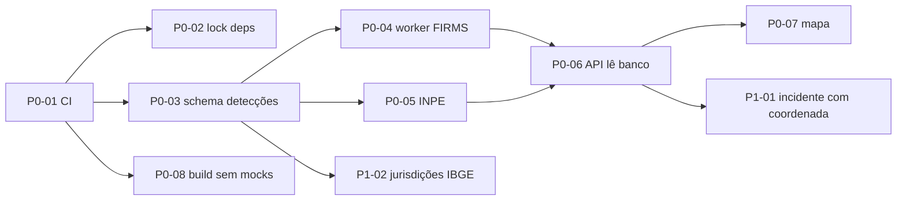

# IGNIS — Backlog técnico da Fase 1 (Dados reais)

Data: 03/11/2026. Escrito para que outro agente ou desenvolvedor comece sem redescobrir a arquitetura. Leia antes: [ARCHITECTURE](ARCHITECTURE.md) §3–4, [API-INVENTORY](API-INVENTORY.md), [DATA-SOURCES](DATA-SOURCES.md) §5 e [SPRINT-0-DELIVERY](SPRINT-0-DELIVERY.md).

**Ponto de partida:** os PRs da Sprint 0 mergeados (backend em `main`, frontend em `master`). Se ainda não estiverem, trabalhe a partir das branches `audit/ignis-sprint-0`.

## 1. Definição de pronto da Fase 1

- [ ] CI verde obrigatório nos dois repositórios (lint, typecheck, testes, build, migrations em PostGIS).
- [ ] Detecções FIRMS (e INPE) ingeridas por **worker agendado**, gravadas em PostGIS, deduplicadas, com `ingestion_runs` honesto.
- [ ] `GET /api/v1/orbital-alerts` lê **do banco** (`persisted=true`), com filtros de período, bbox e jurisdição, e paginado.
- [ ] Mapa plota as detecções com a coordenada real, legenda de fonte e horário de observação e de ingestão.
- [ ] Build operacional do frontend **não contém mocks**. O modo demo vive em ambiente separado.
- [ ] Nenhum indicador sem fonte; nenhuma ação sem estado explícito (regra da Sprint 0 mantida por testes).
- [ ] Riscos R-01, R-03 e R-04 do SECURITY-REVIEW tratados.

## 2. Ordem de execução

## 3. Itens P0

### P0-01 — CI nos dois repositórios
- **Backend:** GitHub Actions com `ruff check`, `pytest` e job com serviço `postgis/postgis:16-3.4` rodando `alembic upgrade head`, `alembic downgrade base` e `upgrade head`, mais `alembic check` filtrando os schemas `tiger`/`topology` (criar `include_object` em `alembic/env.py`).
- **Frontend:** `npm ci`, `npm run typecheck`, `npm run lint`, `npm test` e `npm run build`.
- **Aceite:** PR com teste quebrado fica vermelho; badge no README.
- **Dependências:** nenhuma. Esforço: P.

### P0-02 — Dependências reprodutíveis no backend
- Gerar `uv.lock` (ou `requirements.lock` com hashes) a partir do `pyproject.toml`.
- O Dockerfile instala do lock. Adicionar `pip-audit` na CI.
- **Aceite:** build idêntico em duas máquinas; `pip-audit` na CI.
- **Esforço:** P.

### P0-03 — Modelo de detecções orbitais (PostGIS)
> **Implementado na Sprint 1.1** com ajustes (migration `a013_geo_foundation`, ver [SPRINT-1.1-DELIVERY](SPRINT-1.1-DELIVERY.md) §3):
> - sem `is_demo`: detecção demonstrativa não é gravada;
> - sem `area_id` até existir base oficial de UCs;
> - `jurisdiction_id` obrigatório;
> - contadores com constraints de balanço.

- Migration aditiva `a013_create_orbital_detections` com as tabelas:
  - `orbital_detections`, com as colunas:
    - `id uuid pk`;
    - `source text not null` (ex.: `NASA_FIRMS_VIIRS_SNPP_NRT`, `INPE_QUEIMADAS`);
    - `source_record_key text not null` (chave natural do provedor);
    - `dedup_key text not null unique` (UUIDv5, já implementado em `nasa_firms/service.py::_stable_alert_id`);
    - `observed_at timestamptz not null`;
    - `ingested_at timestamptz not null default now()`;
    - `location geometry(Point,4326) not null` com índice GIST;
    - `confidence smallint`, `frp numeric`, `satellite text`, `instrument text`, `daynight char(1)`;
    - `raw jsonb not null`;
    - `ingestion_run_id uuid fk`;
    - `area_id uuid null fk protected_areas` (preenchido por `ST_Intersects`);
    - `is_demo boolean not null default false`.
  - `ingestion_runs`: `id`, `source`, `started_at`, `finished_at`, `status` (`ok|partial|unavailable|disabled|error`), `records_fetched`, `records_valid`, `records_inserted`, `records_duplicate`, `error_type`, `params jsonb`.
- Modelos com `DateTime(timezone=True)`; não repetir B-13.
- **Aceite:** upgrade/downgrade testados na CI; `records_inserted` vem de `INSERT … ON CONFLICT (dedup_key) DO NOTHING RETURNING id`.
- **Esforço:** M.

### P0-04 — Worker de ingestão NASA FIRMS
> **Implementado na Sprint 1.2** com ajustes ([SPRINT-1.2-DELIVERY](SPRINT-1.2-DELIVERY.md)):
> - job cron `orbital-ingest` (uma rodada por execução) em vez de processo contínuo;
> - 4 produtos NRT;
> - recuperação por *lease* (advisory lock de sessão) em vez de `pg_try_advisory_lock` global;
> - `POST /ingest` devolve 202 com as execuções reais.

- Novo processo `python -m app.workers.ingest` (serviço separado no deploy), com agendamento a cada 30 min (config `FIRMS_INGEST_INTERVAL_MINUTES`).
- Reusar `nasa_firms/client.py`: validação de CSV e mensagens sem a chave já estão prontas.
- Janela de 1–2 dias (`FIRE_LOOKBACK_DAYS`), bbox do Ceará configurável (`FIRE_BBOX`; hoje `_DEFAULT_BBOX` cobre CE/PI/MA/TO).
- Lock para execução única (`pg_try_advisory_lock`).
- Backoff em falha. Cada execução grava um `ingestion_runs`.
- `POST /orbital-alerts/ingest` (admin) passa a **enfileirar ou executar** uma execução e devolve o `ingestion_run`.
- **Aceite:**
  1. teste com CSV fixo grava N linhas, e a reexecução grava 0 (duplicadas);
  2. falha HTTP gera `status=unavailable` sem a chave em lugar nenhum;
  3. `records_inserted` bate com `SELECT count(*)`.
- **Dependências:** P0-03. Esforço: M.

### P0-05 — Ingestão INPE (Programa Queimadas)
> **Implementado na Sprint 1.2** com o CSV diário de dados abertos em vez do WFS (justificativa em SPRINT-1.2-DELIVERY §2.2). Nada do PR #2 foi reaproveitado.

- Rebasear o cliente do PR #2 (`app/integrations/inpe_queimadas/`) sobre o contrato da Sprint 0. **Não** reaproveitar o agregador com fallback demo (X-05).
- Normalizar para `orbital_detections` com `source=INPE_QUEIMADAS`.
- Deduplicação entre fontes: mesma posição dentro de 375 m e janela de ±30 min mantém os dois registros e os vincula por `cluster_id`. Não apagar nenhum.
- Fechar o PR #2 com referência a este item.
- **Aceite:** testes com amostra WFS gravada; documentação de termos e atribuição do INPE.
- **Dependências:** P0-03. Esforço: M.

### P0-06 — API de leitura a partir do banco
- `GET /api/v1/orbital-alerts?from&to&bbox&source&area_id&page&size` lê de `orbital_detections`.
- Resposta com `persisted=true`, `data_origin` por item, `last_successful_run` e `source_status` derivado do último `ingestion_run`: `stale` se a última execução bem-sucedida tiver mais de 2× o intervalo. Adicionar `stale` ao enum.
- Manter os campos da Sprint 0. Remover a busca sob demanda na NASA pela rota pública.
- **Aceite:**
  - testes de contrato para `live`/`stale`/`disabled`/`unavailable`;
  - performance: 10 mil detecções no bbox do CE em menos de 300 ms com o índice GIST (medir);
  - a UI mostra `observed_at` e `ingested_at`.
- **Dependências:** P0-04. Esforço: M.

### P0-07 — Mapa com detecções reais
- `OrbitalMapPage` e `WarRoomPage` ganham a camada "Detecções orbitais", com cluster (`leaflet.markercluster` ou canvas renderer; justificar a dependência).
- Popup com fonte, `observed_at`, confiança e o aviso "anomalia térmica ≠ incêndio".
- Filtro de período. Legenda com o estado da fonte.
- Trocar o provedor de tiles (R-10) via `VITE_TILE_URL` e `VITE_TILE_ATTRIBUTION`.
- **Aceite:** coordenada exibida = coordenada do banco (teste do adapter); nenhum marcador sem fonte; atribuição correta.
- **Dependências:** P0-06. Esforço: M.

### P0-08 — Build operacional sem mocks
- Separar `src/data/*` num módulo carregado **só** quando `VITE_USE_API=false` (import dinâmico) e falhar o build operacional se algum mock for importado (regra ESLint `no-restricted-imports` + teste).
- Hooks em modo API: estado de erro explícito por widget (componente `SourceUnavailable`), sem substituição.
- Publicar o modo demo num deploy separado (`demo.`), com seed próprio.
- **Aceite:** `grep` do bundle operacional não encontra os ids mock (`IGN-CE-2026-0041`, `demo-firms-*`); testes dos hooks em erro.
- **Esforço:** M.

## 4. Itens P1

| ID | Item | Aceite | Dep. | Esforço |
|---|---|---|---|---|
| P1-01 | **Incidente com coordenada própria**: usar `incidents.latitude/longitude/location` (já existem) no adapter e no mapa; foco desenhado na coordenada, não no centro da área | Teste do adapter; mapa sem `area.center` para focos | P0-06 | P |
| P1-02 | **Jurisdições**: tabela `jurisdictions` (código IBGE, nome, UF, geometria oficial IBGE) carregada por script idempotente; `area_id`/`jurisdiction_id` por `ST_Intersects` na ingestão | Os 184 municípios do CE carregados; detecção recebe jurisdição | P0-03 | M |
| P1-03 | **Limites oficiais das UCs** (CNUC/ICMBio, SEMA-CE) substituindo polígonos estimados; `source` e `data_quality` reais | Áreas com fonte oficial e data | — | M |
| P1-04 | **Endpoint público sanitizado** `GET /api/v1/public/incidents` (sem dados internos ou pessoais) para o portal (B-15) | Portal sem chamada a endpoint de gestor | — | P |
| P1-05 | **Redis** para cache e rate limit compartilhado; `TRUST_PROXY_HEADERS` configurado no proxy real (R-04) | Limite efetivo igual com 2 workers (teste de integração) | — | P |
| P1-06 | **Timezone**: modelos com `DateTime(timezone=True)` e remoção de `replace(tzinfo=None)`; migration de verificação (B-13) | `alembic check` sem diffs de tipo | P0-01 | P |
| P1-07 | **Máquina de estados de incidente** + motivo obrigatório + papel mínimo por transição + auditoria em `events` (B-12, B-19) | Testes de transições inválidas → 409 | — | M |
| P1-08 | **Sessão no frontend**: cookie HttpOnly + CSRF (R-07). A CSP já está no nginx do Railway | Token fora do `localStorage`; CSP mantida | — | M |
| P1-09 | **Exibir "atualizado às HH:MM"** por widget (`dataUpdatedAt` do React Query) e dado em cache marcado como tal | Todo widget com fonte e horário | P0-08 | P |
| P1-10 | **Usuários demo em produção** (R-01): script de verificação/desativação idempotente, executado só com aprovação do proprietário | Relatório de usuários demo = 0 em produção | decisão | P |

## 5. Itens P2

| ID | Item |
|---|---|
| P2-01 | Seed com domínios `*.example` (B-16) e migração dos logins demo |
| P2-02 | Login com custo constante + auditoria de falhas + bloqueio progressivo por conta (B-17) |
| P2-03 | Upgrade major de `zod` (v4) e `react-router` (v7) com testes de formulários e rotas (R-08) |
| P2-04 | Exclusão lógica de áreas; proteção do último admin (B-20) |
| P2-05 | Exportar o OpenAPI para `docs/openapi.json` na CI (base da Fase 4) |
| P2-06 | Remover as 10 warnings de lint (react-refresh) e ativar `strict` gradualmente no `tsconfig` |

## 6. Decisões já tomadas (não reabrir sem evidência)

- Backend Python/FastAPI + PostGIS permanece (ARCHITECTURE D-1).
- Leaflet na Fase 1 (D-5).
- Detecção orbital nunca vira incidente sem validação humana (ARCHITECTURE §3, princípio 4).
- Sem fallback para mock em modo API (D-4).
