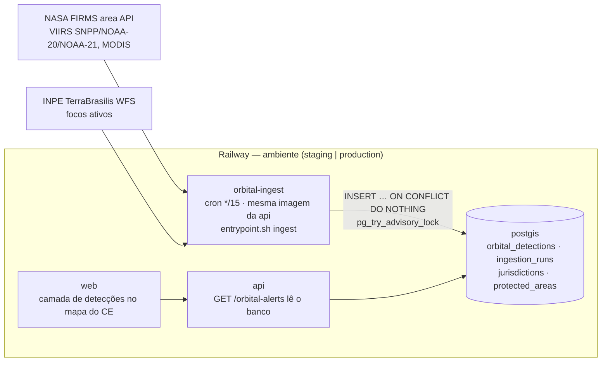

# IGNIS — Plano de execução da Fase 1: dados reais do Ceará

Data: 03/11/2026, atualizado em 04/11/2026. **Status:** Sprints 1.1 e 1.2 entregues em PRs empilhados, sem merge ([SPRINT-1.1-DELIVERY](SPRINT-1.1-DELIVERY.md), [SPRINT-1.2-DELIVERY](SPRINT-1.2-DELIVERY.md)). As Sprints 1.3 e 1.4 não foram iniciadas.
O plano detalha **como** executar o [PHASE-1-BACKLOG](PHASE-1-BACKLOG.md) na plataforma Railway ([RAILWAY-DEPLOYMENT](RAILWAY-DEPLOYMENT.md)). Os IDs `P0-xx`/`P1-xx` são os do backlog.

## 1. Objetivo e resultado esperado

Ao final da Fase 1, o mapa do IGNIS mostra **focos de calor reais sobre o Ceará**. Cada foco:
- vem do INPE (Programa Queimadas) ou da NASA FIRMS (VIIRS/MODIS);
- foi ingerido por um job agendado e persistido em PostGIS;
- é deduplicado;
- está associado ao município (IBGE) e, quando houver, à unidade de conservação;
- exibe fonte, horário de observação e horário de ingestão.

Quando a fonte falha, a interface diz que falhou (`unavailable`/`stale`). Ela nunca substitui o dado por demonstração.

**Fora do escopo:** previsão de risco, despacho de equipes e integração com o OrkenGov (Fases 2 a 4).

## 2. Ponto de partida

| Já entregue | Onde |
|---|---|
| CI obrigatória, lock com hashes, pip-audit (P0-01, P0-02) | Sprint 0/0.1 |
| Contrato honesto de `orbital-alerts` (`source_status`, `persisted=false`) | Sprint 0 |
| Cliente FIRMS com validação de CSV, backoff e chave fora dos logs | `app/integrations/nasa_firms/` |
| Infra Railway: staging/production, PostGIS 16-3.4, pre-deploy `migrate` | `.railway/railway.ts` |
| Job agendado `orbital-ingest` (cron `*/15`), pronto e desligado (Sprint 1.2) | `railway.ts` (`ENABLE_ORBITAL_INGEST_JOB`, `ingestJob()`) |

**Pré-requisitos do proprietário:**
- merge dos PRs da Sprint 0/0.1 e desta preparação;
- staging provisionado e homologado;
- `NASA_FIRMS_MAP_KEY` de staging, de preferência uma chave distinta da de produção, porque a cota é por chave;
- decisão sobre o provedor de tiles (R-10);
- decisão D-1 (região/LGPD).

## 3. Arquitetura da Fase 1

Decisões de desenho:

- **Job agendado, não daemon.** Cada execução do cron do Railway faz uma rodada completa (busca → valida → grava → registra `ingestion_runs`) e termina, com `restartPolicy NEVER`.
  - Não há processo de longa duração para monitorar nem estado em memória.
  - O `pg_try_advisory_lock` garante que duas rodadas nunca se sobreponham.
- **Mesma imagem da API** (papel `ingest` no `entrypoint.sh`): uma única cadeia de build, dependências e migrações.
- **Idempotência pela chave natural.** `dedup_key` = UUIDv5 de (fonte, satélite, `acq_datetime`, lat/lon arredondados). Reprocessar uma janela grava 0 linhas.
- **Geografia no banco:**
  - `area_id` e `jurisdiction_id` são preenchidos na ingestão por `ST_Intersects`;
  - o recorte do Ceará é feito pelo polígono oficial do IBGE, não por bbox;
  - o bbox só reduz a consulta ao provedor (`-41.5,-7.9,-37.2,-2.7`).

## 4. Sprints

Cada sprint termina com CI verde, deploy em **staging** pelo fluxo normal, os itens correspondentes do HOMOLOGATION-CHECKLIST e um relatório de entrega. Produção só recebe código com a promoção aprovada pelo proprietário.

### Sprint 1.1 — Fundação de dados (P0-03, P1-02, P1-06 parcial) — **entregue em PR**

O que mudou em relação ao plano abaixo:
- malha **IBGE 2025** (referência 30/04/2025) em vez de 2022 (decisão S1.1-D1);
- o papel `firms-ingest` passou para a Sprint 1.2, porque os workers estão fora do escopo autorizado;
- `area_id` (UC) foi adiado até existir base oficial de UCs (S1.1-P2).

| Entrega | Detalhe | Aceite |
|---|---|---|
| Migração `orbital_detections` + `ingestion_runs` | Esquema do P0-03, com `timestamptz`, índice GIST em `location`, `unique(dedup_key)` | upgrade/downgrade na CI; `alembic check` sem diff |
| `jurisdictions` | 184 municípios do CE + o polígono da UF (malha IBGE 2022, SIRGAS 2000 → WGS84). Script idempotente `python -m seed.jurisdictions`, que **pode** rodar em staging/production porque são dados oficiais, não demo | Contagem = 184; `ST_IsValid` em todos; reexecução sem duplicar |
| Papel `firms-ingest` no `entrypoint.sh` | Valida a configuração, espera o banco e executa uma rodada | Teste do contrato de papéis (já existe para `api`/`migrate`) |

### Sprint 1.2 — Ingestão real (P0-04, P0-05) — **entregue em PR**

O que mudou em relação ao plano abaixo:
- INPE pelo CSV diário de dados abertos, não pelo WFS;
- recuperação por *lease* no lugar do `pg_try_advisory_lock` global;
- vínculo entre fontes (`cluster_id`) adiado: os dois registros são preservados;
- job pronto, mas **não ligado** (precisa de autorização);
- FIRMS validada só com fixtures (sem chave real).

| Entrega | Detalhe | Aceite |
|---|---|---|
| Rodada FIRMS | Fontes VIIRS SNPP/NOAA-20/NOAA-21 NRT e MODIS NRT. Janela de 1 dia com sobreposição. Bbox do CE. Validação de CSV existente. Status `ok/partial/unavailable/disabled` em `ingestion_runs` | CSV fixo grava N; reexecução grava 0; falha HTTP → `unavailable` sem a chave em lugar nenhum; `records_inserted` = `count(*)` |
| Rodada INPE | Cliente WFS (rebase do PR #2 **sem** o agregador com fallback demo); `source=INPE_QUEIMADAS`; atribuição e termos documentados | Amostra WFS gravada nos testes; PR #2 fechado com referência |
| Vínculo entre fontes | Mesmo foco (≤ 375 m, ±30 min) mantém os dois registros, ligados por `cluster_id`. Nenhum registro é apagado | Teste com par FIRMS × INPE |
| Ligar o job em **staging** | `ENABLE_ORBITAL_INGEST_JOB=true` → contrato do IaC atualizado (o check passa a exigir o serviço) → `railway config plan/apply` em staging | 48 h de execuções em staging sem `error`; `ingestion_runs` coerentes |
| `POST /orbital-alerts/ingest` | Dispara uma rodada (admin, auditado) e devolve o `ingestion_run` | 401/403 para não-admin; auditoria registrada |

### Sprint 1.3 — Leitura e mapa do Ceará (P0-06, P0-07, P1-09)

| Entrega | Detalhe | Aceite |
|---|---|---|
| `GET /orbital-alerts` lê o banco | Filtros `from/to/bbox/source/area_id/jurisdiction_id`, paginado. `persisted=true`. `source_status` derivado do último `ingestion_run` (`stale` se tiver mais de 2× o intervalo) | Testes de contrato `live/stale/disabled/unavailable`; 10 mil detecções no CE em menos de 300 ms (medido com `EXPLAIN ANALYZE` em staging) |
| Mapa do Ceará | Camada "Focos de calor" com cluster (canvas renderer do Leaflet; dependência nova só com justificativa). Contorno da UF e dos municípios. UCs existentes. Filtro de período (24 h/48 h/7 d). Legenda com o estado de cada fonte | A coordenada exibida é a do banco (teste do adapter); nenhum marcador sem fonte; aviso "foco de calor ≠ incêndio confirmado" |
| Horários por widget | "Observado às" e "ingerido às", e dado em cache marcado como tal | Todo widget com fonte e horário |
| Tiles | `VITE_TILE_URL`/`VITE_TILE_ATTRIBUTION`. A CSP `img-src` passa a incluir o provedor escolhido (`deploy/nginx`) | Atribuição correta; zero violações de CSP |

### Sprint 1.4 — Endurecimento e go-live (P0-08, P1-04, P1-05, R-01/R-03/R-04)

| Entrega | Detalhe | Aceite |
|---|---|---|
| Build operacional sem mocks | `src/data/*` só com `VITE_USE_API=false` (import dinâmico + `no-restricted-imports` + teste) | `grep` do bundle operacional sem ids mock |
| Portal público sanitizado | `GET /api/v1/public/incidents` e `/public/detections`, sem dados internos | Portal sem chamada a endpoints de gestor |
| Rate limit e cache compartilhados | Mover para o Postgres (tabela com TTL), sem novo serviço, ou para o Redis do ambiente se a medição exigir. Só depois disso a API passa a ter mais de 1 réplica | Limite efetivo igual com 2 réplicas (teste de integração) |
| Homologação e promoção | HOMOLOGATION-CHECKLIST completo + os itens de dados da Fase 1 (§5) em staging → `promote.yml` → produção | Aprovação do proprietário registrada |

## 5. Critérios de aceite de dados (adicionados à homologação)

| # | Verificação | Esperado |
|---|---|---|
| D-01 | Comparar 24 h de focos no CE entre o IGNIS e o portal do INPE e o FIRMS Fire Map | Mesma ordem de grandeza por satélite; divergências explicadas (janela, latência, recorte) |
| D-02 | Reexecutar a mesma janela | `records_inserted=0`, `records_duplicate=N` |
| D-03 | Derrubar o acesso ao FIRMS (chave inválida em staging) | Execução `unavailable`; API com `source_status` honesto; mapa com aviso; nenhum dado inventado |
| D-04 | Foco dentro de uma UC conhecida | `area_id` preenchido; popup com o nome da UC |
| D-05 | Fuso horário | `observed_at` em UTC no banco; exibido em America/Fortaleza na UI |

## 6. Riscos e mitigações

| Risco | Mitigação |
|---|---|
| Cota da API FIRMS (transações por chave a cada 10 min) | Uma consulta por fonte por rodada; chaves distintas para staging e produção; `disabled`/`unavailable` honestos |
| INPE WFS instável, ou termos de uso restritivos | Confirmar termos e atribuição antes da Sprint 1.2; o FIRMS sozinho já cumpre o objetivo mínimo |
| "Foco de calor" lido como "incêndio" | Linguagem e aviso no popup e na legenda; nenhum incidente é criado automaticamente na Fase 1 |
| Política de uso dos tiles OSM (R-10) | Provedor definido pelo proprietário antes da Sprint 1.3 |
| Região do Railway fora do Brasil (LGPD) | Decisão D-1 antes do go-live. Os focos são dados públicos, mas as denúncias (Fase 0) têm dados pessoais |
| Volume do banco | ~ dezenas de milhares de focos/ano no CE: volume de 5–10 GB folgado. Política de retenção do `raw jsonb` a definir na Sprint 1.4 |

## 7. Estimativa e governança

- **Duração:** 4 sprints de 1 semana (cerca de 4 semanas corridas), desde que os pré-requisitos de §2 estejam resolvidos.
- **Cada sprint:**
  - PR por item, com CI, Sonar e GitGuardian ativos;
  - sem merge nem promoção sem autorização;
  - relatório com evidências (no padrão do SPRINT-0-DELIVERY).
- **Primeiro passo executável quando autorizado:** Sprint 1.1, migração `orbital_detections` + `ingestion_runs` num PR para `main`.
