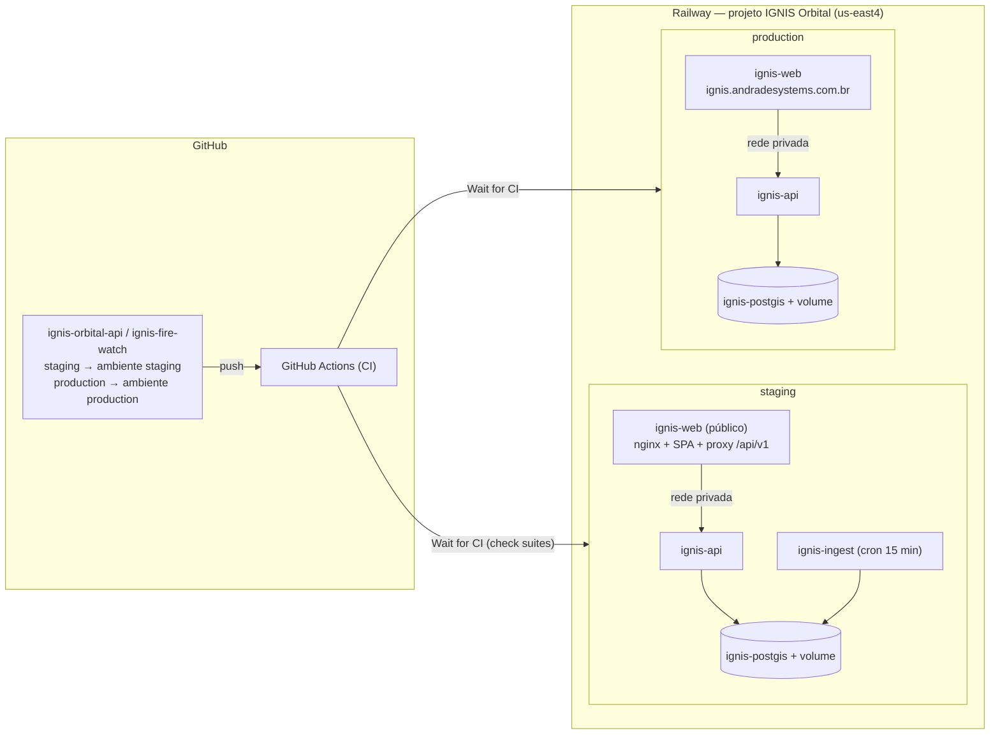

# IGNIS — Implantação no Railway

Atualizado em 04/11/2026. Decisão do proprietário: **o IGNIS é hospedado exclusivamente no Railway**. A Vercel não faz parte da arquitetura.

> **Estado real (04/11/2026):**
> - O projeto **IGNIS Orbital** existe (`801f5962-4b9a-48dc-a83a-5e8ecb383f81`).
> - O **staging** está implantado e homologado em `https://ignis-web-staging.up.railway.app`.
> - A **produção** está provisionada (banco, volume, segredos e domínio com certificado válido), **sem deploy de aplicação**.
>
> Os detalhes, IDs, evidências e bloqueios estão em [RAILWAY-PROVISIONING-REPORT.md](RAILWAY-PROVISIONING-REPORT.md).

## 1. Visão geral



- **Infraestrutura como código:** `ignis-orbital-api/.railway/railway.ts` (SDK `railway/iac` 3.16.0, CLI ≥ 5.42.1; usado o 5.70.0).
  - O antigo `railway.json` (*Config as Code*) foi depreciado e deixa de funcionar em 01/12/2026.
  - O arquivo descreve os dois ambientes. Cada ambiente é aplicado em separado (`railway environment link <amb>` → `railway config plan` → `railway config apply`).
- **Contrato verificado na CI** (job "Railway IaC"): 28 checagens (§5).
- **No Windows**, o SDK confere a versão do CLI pela variável `_`, que o Git Bash reescreve a cada comando. Por isso, rode `plan`/`apply` pelo PowerShell:
  ```powershell
  $env:_ = "$env:APPDATA\npm\node_modules\@railway\cli\bin\railway.exe"; & $env:_ config plan
  ```

**O que o IaC não faz** (feito por CLI/API e registrado no relatório):
- Domínio personalizado. O Railway recusa registrar pelo IaC: o domínio é criado com `railway domain`, e depois o IaC o declara.
- Domínio gerado do staging (`railway domain --service ignis-web`).
- Agendamento de backups de volume.
- Instâncias de produção de serviços que já existiam: criadas com `environmentPatchCommit`, sem deploy.
- Migração de região de um volume com serviço anexado.

## 2. Ambientes e isolamento

| | staging | production |
|---|---|---|
| Branch (os dois repositórios) | `staging`: branch de implantação, avançado só por fast-forward. Hoje = HEAD de `feat/ignis-admin-cockpit`; depois do merge da pilha, segue o branch padrão | `production`, movido só pelo `promote.yml` (ainda não existe) |
| Banco | `ignis-postgis` + volume próprio (5 GB) | `ignis-postgis` + volume próprio (10 GB) |
| Segredos (`POSTGRES_PASSWORD`, `JWT_SECRET_KEY`) | gerados **só** para staging | gerados **só** para produção |
| `APP_ENV` | `staging` | `production` |
| Domínio | `ignis-web-staging.up.railway.app` | `ignis.andradesystems.com.br` (DNS pendente) |
| Dados | contas de homologação `@example.org`; focos INPE reais | vazio |
| Ingestão | `ignis-ingest`, cron a cada 15 min | desligada (sem serviço) |

Proteções no código contra misturar ambientes (inalteradas):
- `APP_ENV` diferente do ambiente Railway impede o boot (`reject_environment_mismatch`).
- Configuração insegura impede o boot: JWT fraco; `DATABASE_URL` de desenvolvimento; CORS sem HTTPS, com `*` ou com `localhost`.
- O erro de configuração nunca ecoa os valores (`hide_input_in_errors`).
- O seed demonstrativo nunca roda em staging/production.

## 3. Serviços

| Serviço | Origem | Start | Pre-deploy | Healthcheck | Exposição |
|---|---|---|---|---|---|
| `ignis-postgis` | imagem `postgis/postgis:16-3.4` | padrão da imagem | — | — | **privado**, volume em `/var/lib/postgresql/data` (`PGDATA` = `pgdata-2` em staging, `pgdata` em produção) |
| `ignis-api` | `ignis-orbital-api` (Dockerfile; usuário não-root) | `/app/scripts/entrypoint.sh api` | `/app/scripts/entrypoint.sh migrate` (600 s; serializado por advisory lock) | `/ready`, 120 s | **privado** (sem domínio público) |
| `ignis-web` | `ignis-fire-watch` (Dockerfile; nginx-unprivileged) | padrão da imagem | — | `/healthz`, 30 s | **único serviço público** |
| `ignis-ingest` | `ignis-orbital-api` (mesma imagem) | `/app/scripts/entrypoint.sh ingest` (uma rodada e sai) | — | — | privado; cron `*/15 * * * *` só em staging |

Todos rodam com 1 réplica em `us-east4-eqdc4a` (`replicas: { "us-east4-eqdc4a": 1 }`; o campo `deploy.region` **não** é aplicado pelo Railway).

**Same-origin (nginx do `ignis-web`):**
- O build usa `VITE_API_URL=same-origin`: URLs relativas, e o CSP fica com `connect-src 'self'`.
- Na partida, `deploy/nginx/15-ignis-api-proxy.sh` valida `IGNIS_API_UPSTREAM` (`http://host:porta`). Um valor inválido impede o start.
- O nginx encaminha **só** `/api/v1/`, `/health` e `/ready`. `/docs`, `/openapi.json` e tudo o mais ficam no SPA.
- O resolvedor DNS vem de `/etc/resolv.conf`, com `valid=10s`: um redeploy da API não deixa o nginx num IP antigo.
- O `X-Real-IP` escrito pela borda do Railway é repassado à API, que o usa para o rate limit.
- `gzip` para JS/CSS/JSON/GeoJSON. Corpo limitado a 1 MB (a API não tem upload).
- API inalcançável → `503` JSON, com os cabeçalhos de segurança.

## 4. Variáveis e segredos

Nomes, valores e tipos: ver [RAILWAY-PROVISIONING-REPORT.md §8](RAILWAY-PROVISIONING-REPORT.md).

**Regras:**
- No IaC, todo segredo é `preserve()`. A checagem de contrato falha se um segredo aparecer como literal.
- Gerar segredos sem exibi-los:
  ```bash
  python -c "import secrets,sys;sys.stdout.write(secrets.token_hex(32))" | railway variable set NOME --stdin --service <svc> --environment <amb> --skip-deploys
  ```
  Nunca colocar o valor em argumento, chat, log ou arquivo versionado.
- Selar no painel (*Seal*) depois de gravar (pendência B7).
- Variáveis fora do IaC são **removidas** pelo próximo `config apply` (o plano mostra `Delete variable …`). Uma variável temporária deve sair pelo próprio apply, com `--confirm-destructive`.
- Rotação:
  - trocar `JWT_SECRET_KEY` invalida todas as sessões;
  - trocar `POSTGRES_PASSWORD` exige `ALTER USER` no banco antes.
- `NASA_FIRMS_MAP_KEY` não existe: ao homologar a chave, gravá-la por stdin **e** acrescentar `NASA_FIRMS_MAP_KEY: preserve()` ao `ignis-api` e ao `ignis-ingest` no IaC, no mesmo PR.

**Por que `X-Real-IP` e não `X-Forwarded-For`:**
- A borda do Railway sobrescreve `X-Real-IP` em toda requisição.
- Verificado no staging: com `X-Real-IP`/`X-Forwarded-For` forjados, a 11ª tentativa de login da mesma origem recebeu 429.

## 5. Deploy condicionado à CI

| Mecanismo | Onde | Efeito |
|---|---|---|
| **Wait for CI** (`checkSuites: true`) | `railway.ts`, serviços `ignis-api`, `ignis-web` e `ignis-ingest` | O deploy fica em `WAITING` até todas as execuções do GitHub Actions no commit terminarem. Se alguma falhar, o deploy é **descartado** |
| CI roda em `push` para `main`/`master`, `staging` e `production` | `.github/workflows/ci.yml` dos dois repositórios | Requisito do Wait for CI |
| Branch por ambiente | `railway.ts` (`BRANCHES`) | Staging implanta do branch `staging`; produção, do `production`. A checagem de contrato falha se algum ambiente apontar para `main`/`master` ou para um branch `feat/*` |
| Promoção manual | `.github/workflows/promote.yml` dos dois repositórios | Ver abaixo |
| Pre-deploy `migrate` | `railway.ts` | Executa a migração uma vez por deploy, antes de a nova versão receber tráfego. Se falhar, o deploy aborta |
| Healthcheck | `/ready` (api), `/healthz` (web) | Versão que não fica saudável não substitui a anterior |
| `watchPatterns` (api) | `railway.ts` | Mudança só em documentação não redeploya |

**O workflow `promote.yml`** é a única forma prevista de mover `production`:
- disparo manual, com aprovação do environment `production` do GitHub;
- só aceita commit que já está em `main`/`master` e que tem **CI de push bem-sucedida**;
- faz **somente fast-forward** e push **sem `--force`**. O commit promovido é exatamente o que rodou em staging.

A lógica foi testada num repositório descartável, com estes resultados:

| Cenário | Resultado |
|---|---|
| Primeira promoção | aceita |
| Avanço normal | aceito |
| Commit fora de `main` | recusado |
| `production` divergente | recusado |
| Retrocesso por push | recusado pelo git |

Observação: o push feito pelo `GITHUB_TOKEN` não dispara uma nova execução da CI. O Railway usa as *check suites* já concluídas daquele mesmo commit em `main`. Validar esse comportamento na homologação (H-15).

## 6. Configuração no GitHub (proprietário)

1. **Environment `production`** nos dois repositórios (*Settings → Environments*):
   - *Required reviewers* = proprietário;
   - *Deployment branches* = somente o branch padrão.
2. **Ruleset** no branch `production` dos dois repositórios:
   - bloquear *force push* e exclusão;
   - restringir atualizações, com bypass apenas para *GitHub Actions* e o proprietário;
   - exigir os checks da CI.
3. **Ruleset** em `main` (backend) e `master` (frontend): exigir PR e os checks da CI.
4. **Ruleset** no branch `staging` dos dois repositórios: bloquear *force push* e exclusão (só fast-forward por quem homologa).
5. **Frontend:** executar a estratégia de branches (`ignis-fire-watch/docs/IGNIS/BRANCH-STRATEGY.md`): tag de arquivamento de `main`, e `master` como branch padrão. Nenhum force-push, nenhum histórico perdido.
6. **Vercel (transitório):** o projeto Vercel antigo ainda está ligado ao repositório do frontend.
   - O `vercel.json` foi reduzido a `git.deploymentEnabled: false`, para que nenhum merge publique nada lá.
   - O proprietário deve **desconectar o repositório do projeto Vercel**, ou excluir o projeto. Depois disso, o `vercel.json` pode ser removido.


## 7. Provisionamento (executado em 04/11/2026) e como repetir

O que foi feito, em ordem; os detalhes e as correções estão no relatório:

1. `railway init --name "IGNIS Orbital" --workspace <id>`; `railway environment new staging`.
2. Staging:
   1. `config plan` → `config apply`;
   2. segredos por stdin;
   3. `railway domain --service ignis-web` (domínio gerado);
   4. branch `staging` criado nos dois repositórios;
   5. deploy depois da CI.
3. Produção:
   1. instâncias dos serviços criadas sem deploy (`environmentPatchCommit` com `skipDeploys`);
   2. região fixada;
   3. segredos próprios;
   4. `config apply` (sem o domínio);
   5. `railway domain ignis.andradesystems.com.br --service ignis-web --environment production`;
   6. domínio declarado no IaC.
4. Backups de volume diário, semanal e mensal nos dois ambientes (`volumeInstanceBackupScheduleUpdate`).
5. Staging:
   1. primeiro admin (relatório §7);
   2. contas de homologação pelo cockpit;
   3. rodadas manuais de ingestão;
   4. teste de fonte indisponível;
   5. cron ligado.

**Para levar o código novo ao staging:**
```bash
git push origin feat/ignis-admin-cockpit:staging   # fast-forward; nunca --force
```

O Railway espera a CI do commit, migra no pre-deploy e só troca a versão se `/ready` responder.

**Primeiro deploy de produção** (depois dos bloqueios B1–B4 do relatório):
1. Rodar `promote.yml` nos dois repositórios, com aprovação.
2. Acompanhar o deploy.
3. Executar o relatório §12 (primeiro admin).
4. Executar o HOMOLOGATION-CHECKLIST.
5. Conferir o HTTPS do domínio.

Sequência completa: [PRODUCTION-PROMOTION-RUNBOOK.md](PRODUCTION-PROMOTION-RUNBOOK.md).

## 8. Smoke pós-deploy (same-origin)

```bash
WEB=https://ignis-web-staging.up.railway.app      # produção: https://ignis.andradesystems.com.br
curl -sf $WEB/healthz                               # ok
curl -sf $WEB/health                                # {"status":"ok","service":"ignis-orbital-api"}
curl -sf $WEB/ready                                 # {"status":"ready","database":"connected"}
curl -s -o /dev/null -w '%{http_code}\n' -X POST $WEB/api/v1/orbital-alerts/ingest   # 401
curl -s -o /dev/null -w '%{http_code}\n' -X POST $WEB/api/v1/aurora/chat             # 404
curl -s $WEB/api/v1/reports/intake                  # {"accepting":false,...}
curl -s $WEB/docs | grep -c 'id="root"'             # 1 (SPA; a documentação não é exposta)
curl -s -o /dev/null -D - -X OPTIONS $WEB/api/v1/auth/login \
  -H "Origin: https://evil.example.com" -H "Access-Control-Request-Method: POST" | head -1   # 400
curl -sI $WEB/ | grep -i "connect-src 'self'"
```

## 9. Rollback

| Situação | Ação |
|---|---|
| Deploy novo reprovado no healthcheck ou no pre-deploy | Nada a fazer: o Railway mantém a versão anterior |
| CI falhou no commit | O Railway descarta o deploy (*Wait for CI*) |
| Regressão após o deploy | Railway → serviço → *Deployments* → versão anterior → *Rollback* (ou a mutação `deploymentRollback(id)`). Testado em staging (ADMIN-VALIDATION-GUIDE §5). **Não** retroceder branches |
| Migração problemática | Backup lógico antes de cada deploy com migração (relatório §5). Migrações aditivas com `downgrade` testado; nunca `alembic downgrade` em produção sem backup e autorização |
| Vazamento de segredo | Gerar um novo valor por stdin, selar e redeployar |

## 10. Contas, backups e operação

- **Bancos novos:** sem contas demo (o seed é bloqueado). Primeiro admin de produção: relatório §12.
- **Backups:**
  - os backups de volume estão ativos (diário 6 d, semanal 27 d, mensal 89 d);
  - falta o `pg_dump` lógico agendado para fora do Railway;
  - falta o teste de restauração (H-22).
- **Observabilidade:**
  - healthchecks do Railway;
  - o deploy de ingestão com `exit≠0` aparece como falho;
  - cockpit `/admin`;
  - alertas e monitor externo: pendência B8.
- **Nunca** migrar a região de um volume com dados sem parar o banco e sem backup lógico (relatório §4).

## 11. Decisões do proprietário

| # | Decisão | Estado |
|---|---|---|
| D-1 | Região e LGPD | Região **`us-east4-eqdc4a`** em uso. A transferência internacional fica registrada. Denúncias (dados pessoais) estão **fechadas** (`PUBLIC_REPORTS_ENABLED=false`) até o proprietário registrar a análise LGPD |
| D-2 | Domínio próprio | `ignis.andradesystems.com.br` no `ignis-web` de produção; DNS propagado e certificado emitido em 04/11/2026 (relatório §10) |
| D-3 | `/docs` em produção | Decidido no código: nunca público; especificação só para admin |
| D-4 | Desconectar o projeto Vercel | Pendente (§6, passo 6) |
| D-5 | GitGuardian | 33462092, 39541748–39541751, **39592651** e **39592652**: classificar no painel (ADMIN-SECURITY-REVIEW §11) |
| D-6 | Ingestão em produção | Desligada; ligar só depois da homologação de staging, com autorização |

## 12. Ingestão

- `ignis-ingest`: mesma imagem da API, papel `ingest`. Uma rodada por execução (FIRMS + INPE), `restartPolicy NEVER`.
- A rodada registra `ingestion_runs`, com deduplicação pela chave natural e pelo ETag do INPE. O lease (advisory lock) impede rodadas simultâneas.
- O exit code reflete falhas (`2` = fonte indisponível).
- **Staging:** cron `*/15 * * * *` ligado em 04/11/2026, depois de três validações:
  - rodada manual: 320 focos do CE;
  - reexecução idempotente;
  - fonte indisponível registrada como `unavailable`.
- **Produção:** `INGEST.production = { service: false, cron: false }`. Ligar = mudar o IaC num PR revisado, aplicar e observar.
- **FIRMS:** desabilitada (sem chave); estado `disabled/missing_api_key`, nunca dado inventado.
- **Réplicas da API:** 1, enquanto o rate limit e o cache forem em memória.

## 13. Evidências históricas (ambiente local isolado, 03/11/2026)

As evidências do Railway real estão em RAILWAY-PROVISIONING-REPORT §11. Esta seção registra o ensaio local anterior; a arquitetura ainda usava domínio público para a API.

Execução com Docker:
- PostGIS `16-3.4` em rede privada (`ignis-rw`), sem porta publicada;
- imagens construídas a partir dos branches `infra/railway-only`;
- segredos gerados por execução e nunca gravados em arquivo versionado.

| # | Teste | Resultado |
|---|---|---|
| 1 | `migrate` com CORS `http://` em staging | Recusado: "CORS_ORIGINS deve listar apenas origens HTTPS…" (exit 1) |
| 2 | `migrate` com `APP_ENV=production` no ambiente Railway `staging` | Recusado: "APP_ENV=production não corresponde ao ambiente Railway 'staging'" |
| 3 | Pre-deploy `migrate`, comando passado como argumento do ENTRYPOINT | 15 migrações aplicadas até `438a82832b4f`, exit 0 |
| 4 | Pre-deploy `migrate`, ENTRYPOINT substituído (forma usada pelo Railway) | Idempotente, exit 0 |
| 5 | `api` com `MIGRATE_ON_START=false` | Não migra; "Seed demonstrativo ignorado… APP_ENV=staging"; 2 workers |
| 6 | `/health`, `/ready` | `environment: staging`; `database: connected` |
| 7 | `demo_users check` no banco novo | "Nenhuma conta com e-mail demonstrativo ou senha publicada" (exit 0) |
| 8 | Preflight CORS da origem permitida / de origem estranha | 200 com `allow-origin` / 400 sem `allow-origin` |
| 9 | Rate limit de login por `X-Real-IP` com `X-Forwarded-For` forjado | Cliente A: 429 na 12ª tentativa; cliente B, com o mesmo XFF: 401 (não bloqueado) |
| 10 | Build do web com `VITE_API_URL` = `https://` / `http://…railway.app` / com caminho | Os três falham no build, com a mensagem específica |
| 11 | Web: `/healthz`, deep link, asset, asset inexistente | 200 `ok`; 200 HTML `no-cache`; `max-age=31536000`; 404 |
| 12 | Web: processo e arquivos | uid 101; site somente leitura |
| 13 | Navegador: login no web → API (CORS) com admin criado por `bootstrap_admin` | Painel admin com dados da API; auditoria `user.login` e `user.bootstrap_admin_created` |
| 14 | Navegador: mapa público do Ceará sob o CSP | Tiles OSM e áreas protegidas da API, sem violações de CSP no console |
| 15 | Contrato do IaC (`npm run check`) | 20/20; ao apontar produção para `main`, a checagem falha |
| 16 | Suíte do backend | 249 testes, cobertura 79 % |
| 17 | Frontend | typecheck, lint (0 erros), 33 testes |

Para os testes 13 e 14, a API rodou com `APP_ENV=test`, num banco separado (`ignis_e2e`): o CORS de staging exige HTTPS, e o teste local é em `http://localhost`. O comportamento de staging (testes 1 a 9) foi verificado à parte, com a configuração real.
