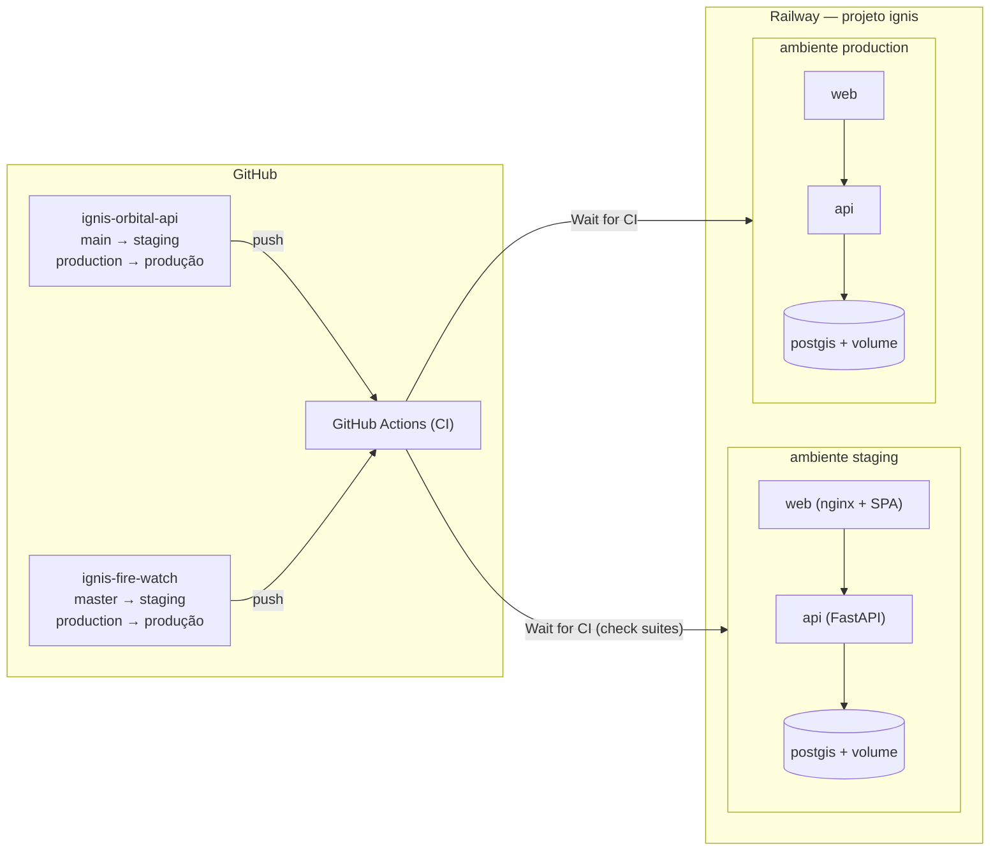

# IGNIS — Plano de implantação no Railway

Data: 03/11/2026. Decisão do proprietário: **o IGNIS é hospedado exclusivamente no Railway**. A Vercel não faz parte da arquitetura.

> **Este documento é um plano.** Nada foi provisionado nem publicado:
> - nenhum projeto Railway foi criado;
> - nenhuma variável ou segredo foi gravado;
> - nenhum deploy foi feito.
>
> Os passos de §7 em diante exigem a **autorização do proprietário**. Tudo o que está aqui foi exercitado em ambiente local isolado (§13).

## 1. Visão geral



- **Infraestrutura como código:** `ignis-orbital-api/.railway/railway.ts` (SDK `railway/iac`, versão fixada).
  - O formato antigo `railway.json` (*Config as Code*) foi depreciado pelo Railway e deixa de funcionar em **01/12/2026**, por isso não é usado.
  - O arquivo declara o projeto inteiro: os dois ambientes e os serviços dos dois repositórios.
- **Contrato verificado na CI** (job "Railway IaC"): tipos e as invariantes de §5, em 20 checagens.

## 2. Ambientes e isolamento

| | staging | production |
|---|---|---|
| Branch da API | `main` | `production` |
| Branch do frontend | `master` | `production` |
| Banco | `postgis` próprio + volume próprio (5 GB) | `postgis` próprio + volume próprio (10 GB) |
| Segredos (`JWT_SECRET_KEY`, `POSTGRES_PASSWORD`, `NASA_FIRMS_MAP_KEY`) | gerados **só** para staging | gerados **só** para produção; nunca copiados de staging |
| `APP_ENV` | `staging` | `production` |
| Domínios | `*.up.railway.app` de staging | `*.up.railway.app` de produção (domínio próprio opcional) |
| Dados | sintéticos/de homologação, **nunca** cópia de produção | reais |

Proteções no código contra misturar ambientes:

- **`APP_ENV` diferente do ambiente Railway impede o boot.** A comparação é com `RAILWAY_ENVIRONMENT_NAME`, injetado pelo Railway. Exemplo: uma configuração de produção colada em staging (`app/config.py`, `reject_environment_mismatch`). Ambientes de PR sempre recebem a configuração de staging.
- **Configuração insegura impede o boot em staging/production:**
  - segredo JWT fraco ou publicado;
  - `DATABASE_URL` de desenvolvimento, sem senha ou com a senha publicada;
  - CORS sem HTTPS, com `*` ou com `localhost`.
- **O seed demonstrativo nunca roda em staging/production**, e não existe forma de liberá-lo.

## 3. Serviços

| Serviço | Origem | Build | Start | Pre-deploy | Healthcheck | Réplicas |
|---|---|---|---|---|---|---|
| `postgis` | imagem `postgis/postgis:16-3.4` (a mesma da CI e do compose) | — | padrão da imagem | — | — | 1, volume em `/var/lib/postgresql/data` |
| `api` | `ignis-orbital-api` | `Dockerfile` (lock com hashes, só wheels, usuário não-root, código somente leitura) | `/app/scripts/entrypoint.sh api` | `/app/scripts/entrypoint.sh migrate` (timeout 600 s) | `/ready` (verifica o banco), 120 s | 1 (ver §12) |
| `web` | `ignis-fire-watch` | `Dockerfile` (Node 22 → nginx-unprivileged 1.28, imagens fixadas por digest) | padrão da imagem | — | `/healthz`, 30 s | 1 |
| `firms-ingest` | `ignis-orbital-api` | `Dockerfile` | job da Fase 1 | — | — | cron `*/15 * * * *`, **desligado** (`ENABLE_FIRMS_INGEST_JOB=false`) |

O banco **não tem domínio público nem TCP proxy**. Só os serviços do mesmo ambiente o alcançam, pela rede privada (`postgis.railway.internal`). A administração é feita por `railway ssh` no serviço `api`, nunca por porta exposta.

**Frontend no Railway:**
- **Build:** valida `VITE_USE_API`/`VITE_API_URL` (`deploy/build-env.mjs`). O build falha se:
  - o domínio da API não resolveu;
  - a URL não usa HTTPS;
  - a URL tem caminho além da origem.
- **Servidor:** o nginx escuta no `PORT` injetado pelo Railway e oferece:
  - `/healthz`;
  - *fallback* de rotas SPA para `index.html`, sempre revalidado;
  - assets com hash em cache de 1 ano, e 404 real para asset inexistente;
  - CSP com `connect-src` restrito à origem da API, mais `X-Frame-Options`, `nosniff`, `Referrer-Policy`, `Permissions-Policy` e HSTS.

## 4. Variáveis e segredos

| Serviço | Variável | Valor | Tipo |
|---|---|---|---|
| postgis | `POSTGRES_USER` / `POSTGRES_DB` | `ignis` | literal (IaC) |
| postgis | `POSTGRES_PASSWORD` | `openssl rand -hex 32` (hex: seguro dentro da URL) | **segredo selado**, por ambiente |
| postgis | `PGDATA` | `/var/lib/postgresql/data/pgdata` | literal |
| postgis | `DATABASE_URL` | `postgresql://…@${{RAILWAY_PRIVATE_DOMAIN}}:5432/…` | referência interna |
| api | `APP_ENV` | `staging` / `production` | literal por ambiente |
| api | `DATABASE_URL` | referência a `postgis.DATABASE_URL`; a API converte `postgresql://` para o dialeto asyncpg | referência |
| api | `JWT_SECRET_KEY` | `python -c "import secrets;print(secrets.token_urlsafe(48))"` | **segredo selado**, por ambiente |
| api | `NASA_FIRMS_MAP_KEY` | chave do proprietário (opcional em staging) | **segredo selado** |
| api | `CORS_ORIGINS` | `https://${{web.RAILWAY_PUBLIC_DOMAIN}}` (+ domínio próprio, se houver) | referência |
| api | `TRUST_PROXY_HEADERS` / `CLIENT_IP_HEADER` | `true` / `x-real-ip` | literal |
| api | `FORWARDED_ALLOW_IPS` | `*` (o contêiner só é alcançável pelo proxy do Railway) | literal |
| api | `MIGRATE_ON_START` | `false` (a migração roda no pre-deploy) | literal |
| api | `WEB_CONCURRENCY` | `2` | literal |
| api | `ORBITAL_ALERTS_DEMO_MODE` | `false` | literal |
| web | `VITE_USE_API` | `true` | literal (build arg) |
| web | `VITE_API_URL` | `https://${{api.RAILWAY_PUBLIC_DOMAIN}}` | referência (build arg) |

**Regras para segredos:**

- No IaC, todo segredo é `preserve()`: o valor vive só no Railway, como variável **selada**. A checagem de contrato falha se um segredo aparecer como literal.
- Gravar os segredos pelo painel (*Seal variable*), um ambiente por vez, **nunca** em linha de comando, chat ou arquivo versionado.
- Se faltar um segredo, o serviço **não sobe**:
  - sem `POSTGRES_PASSWORD`, o PostGIS não inicializa;
  - sem `JWT_SECRET_KEY`, a API recusa o padrão de desenvolvimento.
- Rotação: trocar `JWT_SECRET_KEY` invalida todas as sessões. Para trocar `POSTGRES_PASSWORD`, é preciso também executar `ALTER USER` no banco.

**Por que `X-Real-IP` e não `X-Forwarded-For`:**
- O edge do Railway sobrescreve o `X-Real-IP` em toda requisição.
- O número de saltos do `X-Forwarded-For` não é fixo: a última entrada pode ser um proxy interno compartilhado por todos os clientes. Com a configuração anterior (última entrada do XFF), o rate limit tenderia a juntar todos os usuários num só balde.
- Fonte: respostas da equipe do Railway no [Help Station](https://station.railway.com/questions/which-client-address-headers-does-the-ra-fb9e36d7).
- Há relato de que, com a camada de CDN no caminho, o `X-Real-IP` chegou com o IP do CDN. Por isso, verificar na homologação (HOMOLOGATION-CHECKLIST H-12).

## 5. Deploy condicionado à CI

| Mecanismo | Onde | Efeito |
|---|---|---|
| **Wait for CI** (`checkSuites: true`) | `railway.ts`, serviços `api` e `web` | O deploy fica em `WAITING` até todas as execuções do GitHub Actions no commit terminarem. Se alguma falhar, o deploy é **descartado** |
| CI roda em `push` para `main`/`master` e `production` | `.github/workflows/ci.yml` dos dois repositórios | Requisito do Wait for CI |
| Branch por ambiente | `railway.ts` (`BRANCHES`) | **Merge em `main`/`master` só chega a staging.** A checagem de contrato falha se produção apontar para `main`/`master` |
| Promoção manual | `.github/workflows/promote.yml` dos dois repositórios | Ver abaixo |
| Pre-deploy `migrate` | `railway.ts` | Executa a migração uma vez por deploy, antes de a nova versão receber tráfego. Se falhar, o deploy aborta |
| Healthcheck | `/ready` (api), `/healthz` (web) | Versão que não fica saudável não substitui a anterior |
| `watchPatterns` (api) | `railway.ts` | Mudança só em documentação não redeploya |

**O workflow `promote.yml`** é a única forma prevista de mover `production`:
- disparo manual, com aprovação do environment `production` do GitHub;
- só aceita commit que já está em `main`/`master` e que tem **CI de push bem-sucedida**;
- faz **somente fast-forward** e push **sem `--force`**. O commit promovido é exatamente o que rodou em staging.

A lógica foi testada num repositório descartável, com estes resultados:

| Cenário | Resultado |
|---|---|
| Primeira promoção | aceita |
| Avanço normal | aceito |
| Commit fora de `main` | recusado |
| `production` divergente | recusado |
| Retrocesso por push | recusado pelo git |

Observação: o push feito pelo `GITHUB_TOKEN` não dispara uma nova execução da CI. O Railway usa as *check suites* já concluídas daquele mesmo commit em `main`. Validar esse comportamento na homologação (H-15).

## 6. Configuração no GitHub (proprietário)

1. **Environment `production`** nos dois repositórios (*Settings → Environments*):
   - *Required reviewers* = proprietário;
   - *Deployment branches* = somente o branch padrão.
2. **Ruleset** no branch `production` dos dois repositórios:
   - bloquear *force push* e exclusão;
   - restringir atualizações, com bypass apenas para *GitHub Actions* e o proprietário;
   - exigir os checks da CI.
3. **Ruleset** em `main` (backend) e `master` (frontend): exigir PR e os checks da CI.
4. **Frontend:** executar a estratégia de branches (`ignis-fire-watch/docs/IGNIS/BRANCH-STRATEGY.md`): tag de arquivamento de `main`, e `master` como branch padrão. Nenhum force-push, nenhum histórico perdido.
5. **Vercel (transitório):** o projeto Vercel antigo ainda está ligado ao repositório do frontend.
   - O `vercel.json` foi reduzido a `git.deploymentEnabled: false`, para que nenhum merge publique nada lá.
   - O proprietário deve **desconectar o repositório do projeto Vercel**, ou excluir o projeto. Depois disso, o `vercel.json` pode ser removido.

## 7. Provisionamento inicial (com autorização)

Pré-requisitos:
- PRs #3 e #4 e os PRs desta preparação mergeados;
- CI verde;
- decisões de §11 tomadas.

1. Instalar o CLI do Railway (≥ 5.63) e autenticar com a conta do proprietário.
2. Em `ignis-orbital-api/.railway`, rodar `npm ci`, depois `railway link`, e criar o projeto `ignis` com os ambientes `staging` e `production`.
3. `railway config plan` (**somente leitura**). Conferir:
   - a lista de recursos de §3;
   - os branches;
   - `checkSuites`;
   - os segredos marcados como `preserve`.

   Divergência entre o plano e este documento = parar e corrigir o IaC.
4. `railway config apply`, **primeiro no ambiente `staging`**.
5. Gerar os domínios públicos de `api` e `web`, nas *Settings* de cada serviço. Os dois precisam existir antes do primeiro deploy, porque cada um referencia o domínio do outro (CORS e `VITE_API_URL`).
6. Gravar os segredos selados de staging: `POSTGRES_PASSWORD`, `JWT_SECRET_KEY` e, se houver, `NASA_FIRMS_MAP_KEY`.
7. Aceitar no Railway as permissões do GitHub pedidas pelo *Wait for CI*.
8. Deploy, nesta ordem:
   1. `postgis`;
   2. `api` (o pre-deploy migra o banco);
   3. `web`.
9. **Primeiro administrador**, com `railway ssh --service api --environment staging`:
   ```bash
   python -m seed.bootstrap_admin --email <e-mail-institucional> --name "<Nome>"
   ```
   A senha é digitada no prompt e segue a política da API. A criação é auditada (`user.bootstrap_admin_created`).
10. Executar o **HOMOLOGATION-CHECKLIST** em staging.
11. Com staging homologado, repetir os passos 4 a 9 em `production`, com **segredos novos**. Depois, promover pelo workflow `promote.yml` dos dois repositórios.

## 8. Smoke pós-deploy

```bash
API=https://<dominio-api>; WEB=https://<dominio-web>
curl -sf $API/health        # {"status":"ok",...,"environment":"staging|production"}
curl -sf $API/ready         # {"status":"ready","database":"connected"}
curl -s -o /dev/null -w '%{http_code}\n' -X POST $API/api/v1/orbital-alerts/ingest   # 401
curl -s -o /dev/null -w '%{http_code}\n' -X OPTIONS $API/api/v1/auth/login \
  -H "Origin: https://evil.example.com" -H "Access-Control-Request-Method: POST"     # 400
curl -sf $WEB/healthz       # ok
curl -sI $WEB/gestor/war-room | grep -i '^content-security-policy'   # connect-src com a origem da API
```

## 9. Rollback

| Situação | Ação |
|---|---|
| Deploy novo reprovado no healthcheck ou no pre-deploy | Nada a fazer: o Railway mantém a versão anterior ativa |
| CI falhou no commit | O Railway descarta o deploy (*Wait for CI*) |
| Regressão após o deploy | Railway → *Deployments* → *Redeploy* da versão anterior. **Não** retroceder o branch `production` (o ruleset bloqueia; o histórico é preservado) |
| Migração problemática | Antes de cada deploy com migração, fazer backup (§10). As migrações atuais são aditivas e têm `downgrade` testado na CI. Mesmo assim, não executar `alembic downgrade` em produção sem backup e sem autorização |
| Vazamento de segredo | Rotacionar o segredo selado e redeployar o serviço |

## 10. Usuários demonstrativos, backups e operação

- **Banco novo:** não haverá contas demo, porque o seed é bloqueado em staging/production.
- **Banco reaproveitado:**
  1. `python -m seed.demo_users check` (exit 4 = há risco);
  2. criar o admin real (`bootstrap_admin`);
  3. com autorização, `deactivate --confirm-host <host>`;
  4. `check` de novo, que deve dar exit 0.

  O procedimento está detalhado e testado em SPRINT-0-DELIVERY §3 e §12.
- **Backups:** o PostGIS roda em imagem própria, não no Postgres gerenciado do Railway. Por isso:
  - ativar os *backups de volume* do Railway (diário + semanal) no `postgis-data` de produção;
  - adicionar `pg_dump` lógico agendado para fora do Railway (por exemplo, S3 `sa-east-1`, no molde do `backup-worker` do OrkenGov);
  - testar a restauração antes do go-live (H-20).
- **Observabilidade:**
  - alertas de deploy e healthcheck do Railway;
  - monitor externo de `/ready` e `/healthz`;
  - revisão trimestral com `demo_users check`.

## 11. Decisões pendentes do proprietário

| # | Decisão | Por que importa |
|---|---|---|
| D-1 | **Região do Railway** | O Railway não tem região na América do Sul. Denúncias contêm dados pessoais: hospedar nos EUA ou na Europa é transferência internacional (LGPD, art. 33). Registrar a base legal ou o mecanismo de transferência e escolher a região (`us-east4-eqdc4a`, Virgínia, tem a menor latência para o Ceará; regiões oficiais: EUA Oeste, EUA Leste, Amsterdã, Singapura) |
| D-2 | Domínio próprio | Opcional. Se houver, incluir em `CORS_ORIGINS` (o CSP do web segue `VITE_API_URL`) |
| D-3 | Exposição de `/docs` em produção | SECURITY-REVIEW R-09 |
| D-4 | Desconectar o projeto Vercel | §6, passo 5 |
| D-5 | Incidente GitGuardian 33462092 | **Pendência administrativa conhecida**, por decisão do proprietário de 03/11/2026: não bloqueia o desenvolvimento. O check do GitGuardian **continua ativo**, as credenciais demonstrativas **não são reutilizadas** (o seed é bloqueado em ambientes operacionais e a API recusa senhas publicadas), e a classificação no painel fica a cargo do proprietário |

## 12. Workers futuros (Fase 1)

- **Ingestão FIRMS como job agendado do Railway:**
  - um serviço `firms-ingest`, construído com a mesma imagem da API;
  - `cronSchedule */15 * * * *` e `restartPolicy NEVER`;
  - já declarado em `railway.ts` atrás de `ENABLE_FIRMS_INGEST_JOB`.

  Ligar só quando o papel `firms-ingest` existir no `entrypoint.sh` e estiver coberto por testes.
- **Requisitos do job:**
  - idempotência por chave natural (satélite, data/hora de aquisição, lat/lon);
  - `pg_advisory_lock`, para que duas execuções não se sobreponham;
  - registro de cada execução (`ingestion_runs`).
- **Réplicas da API:** continuam em 1 enquanto o rate limit e o cache FIRMS forem em memória por processo. Para escalar, mover esse estado para o banco ou para um Redis do próprio ambiente.

## 13. Evidências (ambiente local isolado, 03/11/2026)

Execução com Docker:
- PostGIS `16-3.4` em rede privada (`ignis-rw`), sem porta publicada;
- imagens construídas a partir dos branches `infra/railway-only`;
- segredos gerados por execução e nunca gravados em arquivo versionado.

| # | Teste | Resultado |
|---|---|---|
| 1 | `migrate` com CORS `http://` em staging | Recusado: "CORS_ORIGINS deve listar apenas origens HTTPS…" (exit 1) |
| 2 | `migrate` com `APP_ENV=production` no ambiente Railway `staging` | Recusado: "APP_ENV=production não corresponde ao ambiente Railway 'staging'" |
| 3 | Pre-deploy `migrate`, comando passado como argumento do ENTRYPOINT | 15 migrações aplicadas até `438a82832b4f`, exit 0 |
| 4 | Pre-deploy `migrate`, ENTRYPOINT substituído (forma usada pelo Railway) | Idempotente, exit 0 |
| 5 | `api` com `MIGRATE_ON_START=false` | Não migra; "Seed demonstrativo ignorado… APP_ENV=staging"; 2 workers |
| 6 | `/health`, `/ready` | `environment: staging`; `database: connected` |
| 7 | `demo_users check` no banco novo | "Nenhuma conta com e-mail demonstrativo ou senha publicada" (exit 0) |
| 8 | Preflight CORS da origem permitida / de origem estranha | 200 com `allow-origin` / 400 sem `allow-origin` |
| 9 | Rate limit de login por `X-Real-IP` com `X-Forwarded-For` forjado | Cliente A: 429 na 12ª tentativa; cliente B, com o mesmo XFF: 401 (não bloqueado) |
| 10 | Build do web com `VITE_API_URL` = `https://` / `http://…railway.app` / com caminho | Os três falham no build, com a mensagem específica |
| 11 | Web: `/healthz`, deep link, asset, asset inexistente | 200 `ok`; 200 HTML `no-cache`; `max-age=31536000`; 404 |
| 12 | Web: processo e arquivos | uid 101; site somente leitura |
| 13 | Navegador: login no web → API (CORS) com admin criado por `bootstrap_admin` | Painel admin com dados da API; auditoria `user.login` e `user.bootstrap_admin_created` |
| 14 | Navegador: mapa público do Ceará sob o CSP | Tiles OSM e áreas protegidas da API, sem violações de CSP no console |
| 15 | Contrato do IaC (`npm run check`) | 20/20; ao apontar produção para `main`, a checagem falha |
| 16 | Suíte do backend | 249 testes, cobertura 79 % |
| 17 | Frontend | typecheck, lint (0 erros), 33 testes |

Para os testes 13 e 14, a API rodou com `APP_ENV=test`, num banco separado (`ignis_e2e`): o CORS de staging exige HTTPS, e o teste local é em `http://localhost`. O comportamento de staging (testes 1 a 9) foi verificado à parte, com a configuração real.
