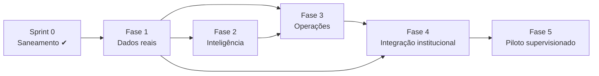

# IGNIS — Roadmap técnico (Fases 1–5)

Data: 03/11/2026. Foco inicial: **queimadas no Ceará**. Outros desastres (enchentes, deslizamentos) só depois da Fase 3, reaproveitando o modelo `detecção → alerta → validação → incidente`.

## Visão geral

| Fase | Objetivo | Entregas principais | Dependências | Critério de aceitação da fase |
|---|---|---|---|---|
| **1 — Dados reais** | Toda informação geoespacial exibida vem de uma fonte rastreável e persistida | CI; workers de ingestão (FIRMS, INPE, Open-Meteo); `orbital_detections` + `ingestion_runs` em PostGIS; deduplicação; histórico; endpoints de leitura do banco; mapa com coordenadas reais; build operacional sem mocks; ambiente demo separado | Sprint 0 mergeada; chave NASA; decisão sobre hospedagem (X-03) | Ver [PHASE-1-BACKLOG](PHASE-1-BACKLOG.md) §1 |
| **2 — Inteligência** | Classificar e priorizar detecções de forma **explicável**, com validação humana | Motor de risco versionado (regras + pesos documentados, depois modelo); correlação detecção × clima × área protegida × histórico; alertas internos com motivo legível; fila de validação por operador; métricas de precisão (validados/descartados) | Fase 1 (histórico ≥ 90 dias recomendado) | Todo alerta mostra fatores, versão do modelo e fonte; nenhum alerta vira incidente sem ação humana registrada; precisão medida em amostra validada |
| **3 — Operações** | Gestão real de incidentes e recursos dentro do IGNIS | Máquina de estados de incidente; equipes e recursos com posição real; missões com check-in persistido; evidências com upload (armazenamento de objetos + hash); War Room com camadas reais; SITREP gerado de dados reais; auditoria append-only | Fase 1; Fase 2 desejável | Nenhuma ação confirma sem persistência; trilha de auditoria completa por incidente; testes E2E dos fluxos críticos |
| **4 — Integração institucional** | Multi-organização e integração com OrkenGov e órgãos | `organizations`/`jurisdictions`/`memberships`; isolamento por organização; IGNIS Command como RP do Orken ID; API v1 + OpenAPI + feed de eventos; módulo OrkenGov IGNIS ([ORKENGOV-INTEGRATION](ORKENGOV-INTEGRATION.md)); LGPD (RIPD) | Fase 3; **acordos formais** com instituições; acesso à Orken Platform | Testes automatizados provando que a organização A não lê nem altera dados da B; contrato OpenAPI testado nos dois repos |
| **5 — Piloto supervisionado** | Validar em ambiente real controlado, sem substituir canais oficiais | Ensaios com cenários simulados; monitoramento (SLO, alertas de pipeline); runbooks; plano de rollback; indicadores (latência detecção→alerta, taxa de falso positivo, disponibilidade); validação institucional | Fase 4; **parceria formal assinada**; aprovação dos órgãos | Critérios acordados com a instituição parceira; nenhum uso operacional sem autorização escrita |

## Prioridades transversais

1. **Confiabilidade antes de funcionalidade:** nada novo entra na UI sem fonte, horário e estado.
2. **Segurança como requisito:** isolamento por organização é bloqueante para qualquer uso por mais de uma instituição.
3. **Sem ação externa automática:** evacuação, mobilização e comunicação à população só com integração oficial, autorização e dupla confirmação, a partir da Fase 4/5.

## Riscos do roadmap

| Risco | Impacto | Mitigação |
|---|---|---|
| Hospedagem atual fora do ar (X-03) | Fase 1 sem ambiente | Decidir a plataforma (Railway ou AWS `sa-east-1`) no início da Fase 1 |
| Ausência de parceria formal | Fases 4–5 bloqueadas | Seguir com dados públicos (FIRMS, INPE) e ambiente demo até a formalização |
| Falso positivo de foco de calor | Perda de confiança institucional | Semântica explícita (anomalia ≠ incêndio), validação humana, métricas |
| Dependência de provedores gratuitos (cotas, termos) | Interrupção da ingestão | Backoff, `ingestion_runs` com alarmes, múltiplas fontes (FIRMS + INPE) |
